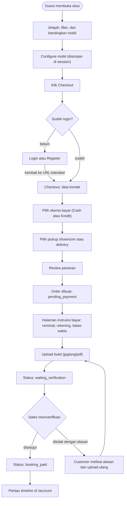
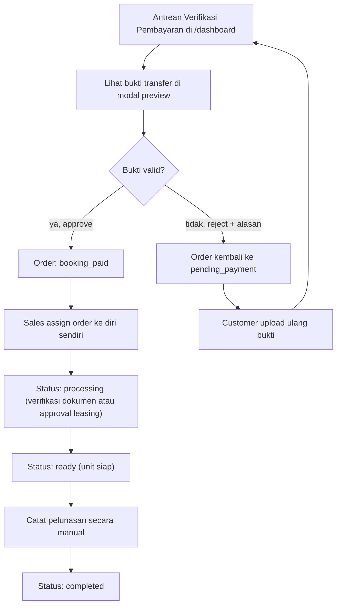
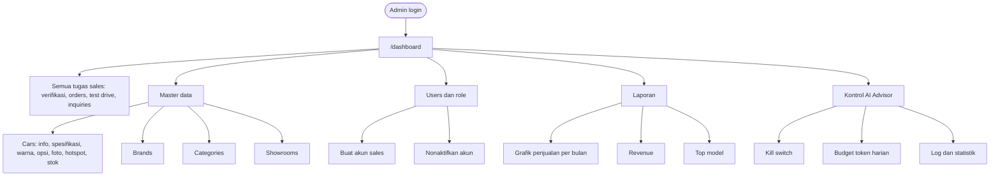
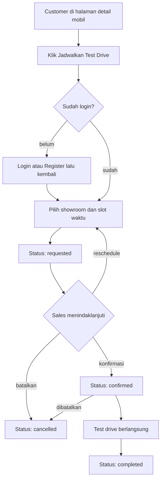
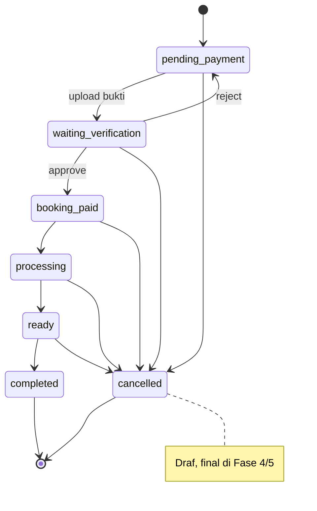
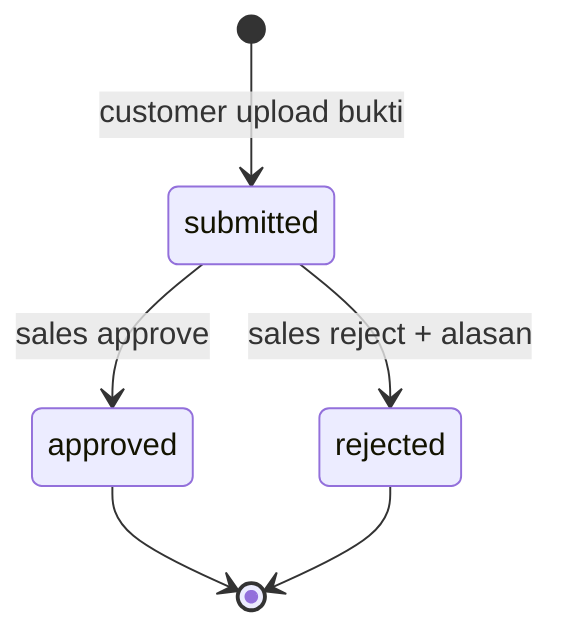
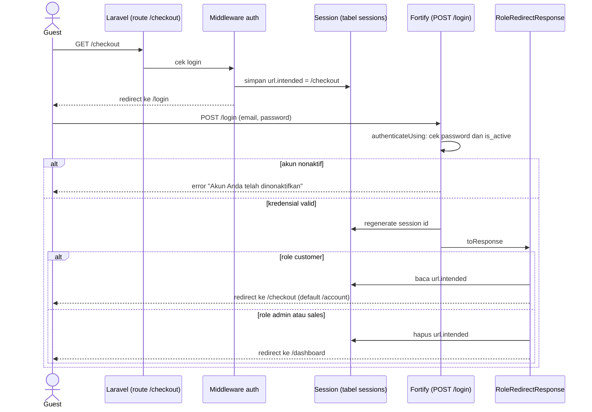
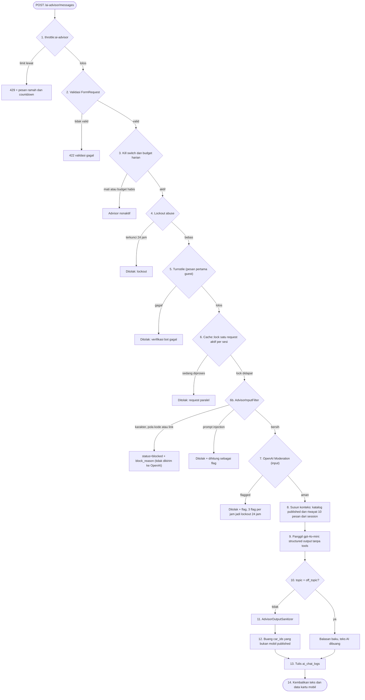
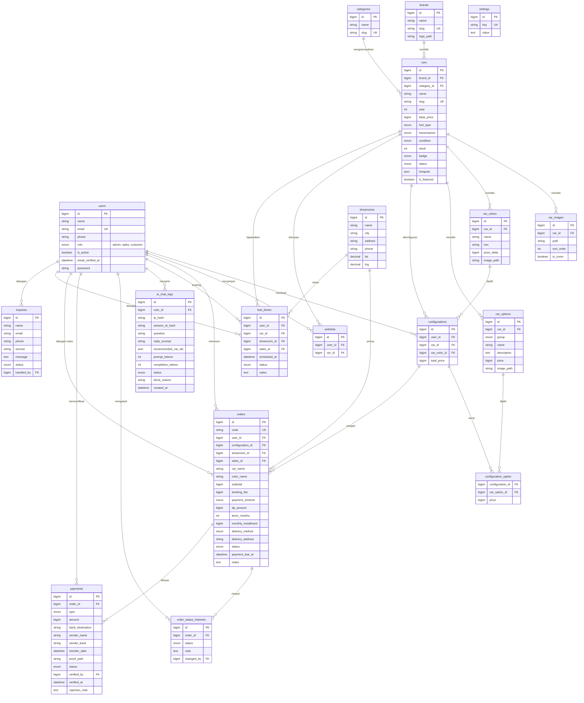
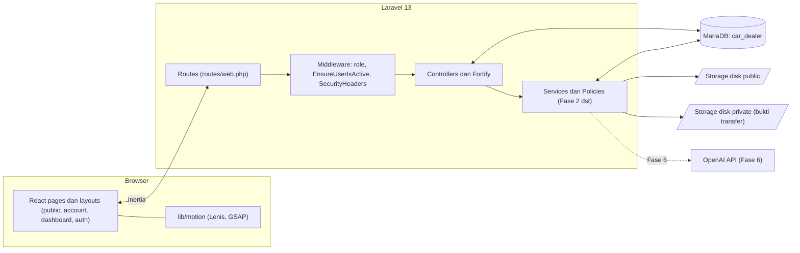

# Flowchart & Diagram — Pemecut Motors

Diagram di bawah ditulis dengan Mermaid, sehingga tampil otomatis di GitHub, dan akan diekspor ke PNG/SVG untuk laporan di Fase 7. Ini adalah draf Fase 1: yang sudah berjalan hanya alur autentikasi dan arsitektur dasar, sisanya adalah rencana dari spesifikasi dan akan diperbarui di akhir setiap fase. Penjelasan teknis ada di [DOKUMENTASI.md](DOKUMENTASI.md).

## Alur Guest → Customer

## Verifikasi Pembayaran & Proses Order (Sales)

## Alur Admin

## Booking Test Drive

## State Diagram Status Order

## State Diagram Status Pembayaran

## Sequence Autentikasi & Session

## Pipeline AI Advisor

## ERD

## Arsitektur

